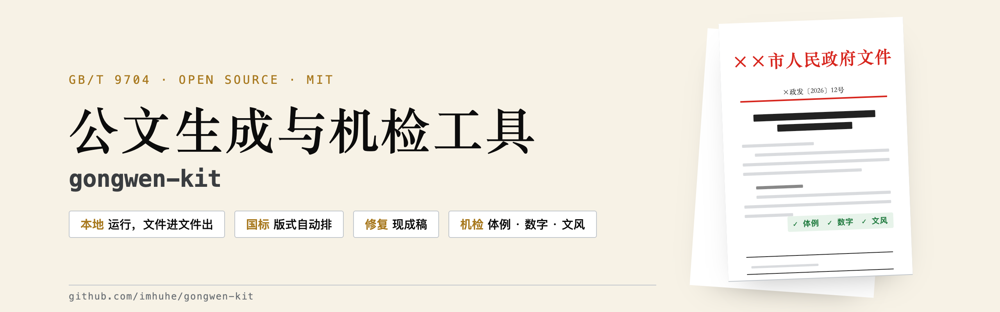
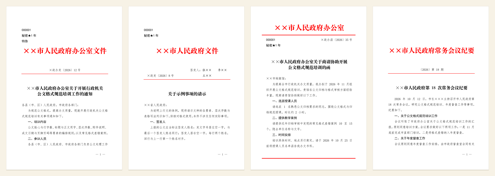

<p align="center"></p>

<p align="center">
  <a href="https://github.com/imhuhe/gongwen-kit/actions/workflows/ci.yml"></a>
  <a href="https://github.com/imhuhe/gongwen-kit/releases"></a>
  
  
  <a href="LICENSE"></a>
</p>

按 GB/T 9704《党政机关公文格式》生成标准 Word 公文，出稿当场机检。写稿人只管内容，
版式交给国标，数字对不对得上交给机检。

面向党政机关、央国企和一般单位的日常公文：通知、报告、请示、函、纪要、管理办法、条例。



## 30 秒上手

```bash
git clone https://github.com/imhuhe/gongwen-kit.git && cd gongwen-kit
npm install
npm test          # 生成五份样张，每份跑完三道机检；再跑九例负对照
```

样张在 `samples/word/`，用 Word 打开即可。

## 它查什么

版式能排对的工具不少。gongwen-kit 多做了一步：**每份稿子写盘后自动跑三道机检，
不过就非零退出**。

| 机检 | 查什么 | 例子 |
|---|---|---|
| 体例 | GB/T 9704 版心、层次序数、日期与发文字号写法、全半角 | `发文字号：年份用六角括号〔〕：【2026】` |
| 数字自洽 | 表格合计与分项、百分比构成、同一指标在不同表格里取值一致 | `第 1 表「合计」行第 2 列：列内 2 项之和 30 ≠ 表内合计 99` |
| 文风 | 异形词、中文里的半角标点（规范层，命中即拦）；套话、黑话、空词（风格层，只提示） | `异形词 1 处（GF 1001-2001）：筹画 → 筹划` |

每条规则都有一份「必错的标本」做负对照，规则报不出来，测试就失败。机检输出可以存成文件，
作为合规凭据留档。

## 能力

- **两种体式**：行文体（报告、请示、函、纪要等）与条文体（管理办法、条例，章条全文连号）
- **版头**：发文机关标志（单个与联合行文）、发文字号、签发人（上行文，回行对齐）、
  红色分隔线；数字红头与预印套打两种形态；份号、密级、紧急程度可选
- **信函格式**（GB/T 9704 10.1）：标志距上页边 30 mm、两条 170 mm 红色双线、
  发文字号居右、首页不印页码、版记只留抄送
- **版记**：抄送机关、印发机关和印发日期、三条分隔线，浮动锚定在版心底部
- **附件页**：另面编排、单附件不编号、不装订附件的发文字号

关键尺寸都在 Word 渲染后量过，例如版头标志上缘距版心 35.05 mm（标准 35），
信函双线长 170.01 mm（标准 170）。量测脚本和全部校准值见 [docs/版式.md](docs/版式.md)。

## 数据在哪里处理

gongwen-kit 本身全部在本机运行，安装后不联网：排版和机检都不调用任何服务。
已经写好的稿子交给它排版、检查，内容不出本机。

让 AI 起草正文时，内容去哪由你用的模型决定。用云端模型，起草的内容会发给模型服务商；
涉密材料要么自己写好只交给它排版检查，要么接内网或本地部署的模型。

## 当作 agent skill 用

Claude Code 与 OpenCode 读同一个目录约定：

```bash
ln -s "$(pwd)" ~/.claude/skills/gongwen-kit
```

之后直接说「按公文格式起草一份关于××的通知」即可。Codex 换成 `~/.codex/skills`（未实测）。

## 写自己的公文

```bash
node tools/new-doc.js --form wen --out 我的稿子.js   # 行文体；条文体用 --form zhang
node 我的稿子.js                                     # 出稿，写盘后自动机检
```

所有构件的用法看 `templates/complete.js`，真实场景看 `templates/notice.js` 与 `templates/xinhan.js`。

体检别人的文件（手写的稿子也可以）：

```bash
node checks/check-doc.js   某文件.docx --strict    # 体例
node checks/check-num.js   某文件.docx --strict    # 数字自洽
node checks/check-style.js 某文件.docx --strict    # 文风
```

导出 PDF 后核字体与版面（可选，需要 `pip install pymupdf`）：

```bash
python3 tools/check-pdf.py 导出件.pdf
```

## 依据

GB/T 9704—2012、GB/T 15834、GB/T 15835、GB/T 1.1、GB/T 8170、GF 1001，
以及《党政机关公文处理工作条例》（中办发〔2012〕14 号）。党政机关适用，其他机关和单位
参照执行。条款对照见 [docs/依据.md](docs/依据.md)。

标题与发文机关标志默认用方正小标宋简体，需要自行安装；没装时的替代方案见
[docs/字体.md](docs/字体.md)。版式在微软 Word 上渲染验收。

## 文档

| 文件 | 内容 |
|---|---|
| [docs/依据.md](docs/依据.md) | 引用的国标与条款对照 |
| [docs/版式.md](docs/版式.md) | 硬指标、校准值、踩过的坑，改版式前必读 |
| [docs/文风.md](docs/文风.md) | 两层判据、词表校准办法、怎么加自己的词 |
| [docs/字体.md](docs/字体.md) | 国标用字对照、方正小标宋授权与替代、字体验证 |
| [SKILL.md](SKILL.md) | 给 agent 的入口（工作流与要素速查） |

## 不做的事

不校对内容与政治表述，判断和责任归写稿人；工具只管形制合规与数字自洽。
不做命令（令）格式、OFD 与电子公文交换、印章图像与数字签章（只预留位置）、公文流转审批、云端服务。

## 维护

个人开源项目，低频维护。issue 会看，不承诺处理时限。许可证 MIT。
